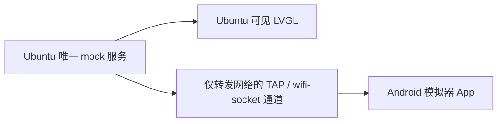

# CarLauncher

应用、JVM 单元测试和设备测试均使用 Kotlin。应用源码位于 `app/src/*/java`，
通用 SOME/IP 客户端独立为 [`:someip-android`](someip-android/README.md)，可构建 AAR。
项目使用 AGP 内置 Kotlin 支持，Room 通过 KSP 生成代码并继续导出到 `app/schemas`；
XML/ViewBinding 界面、数据库版本及车辆线协议保持原有结构。
应用通过 `SomeIpClient` 接口消费事件和发送字节；JNI、网络观察与 native 构建由库封装。

## GitHub 自动构建

[Android Build](.github/workflows/android-build.yml) 在推送、Pull Request 和手动触发时运行，使用 GitHub 的 Ubuntu runner，无需配置 Secrets 或自托管机器。

流水线递归拉取子模块，安装 Java 21，并通过官方 [Android CLI](https://developer.android.com/tools/agents/android-cli) 的 `android sdk install` 管理 Android SDK 36.1、Build Tools 36.0.0、NDK 28.2.13676358、CMake 3.22.1 和 Platform Tools。CLI 使用官方最新安装脚本，运行日志记录实际版本；SDK 路径通过 `ANDROID_HOME` 和 `ANDROID_SDK_ROOT` 同步给 Gradle。
随后从固定版本源码构建 [Boost 和 vSomeIP](third_party/vsomeip-android/README.md)，构建 Debug APK、运行 JVM 单元测试并生成 JaCoCo 覆盖率报告。
成功后在仓库 **Actions → Android Build → 对应运行 → Artifacts** 下载 `CarLauncher-debug-x86_64-*`；测试及覆盖率报告保存为 `CarLauncher-reports-*`，产物保留 14 天。
测试失败时也会尝试上传已有报告。当前 APK 仅支持 x86_64，使用 Android 默认 Debug 签名。

本地验证命令（Java 21）：

Windows 日常构建使用统一入口，首次配置 Ubuntu SSH 地址后即可一条命令编译：

```powershell
# 首次执行；使用自己的 Ubuntu SSH 地址或 ~/.ssh/config 别名
.\build-local.ps1 -UbuntuHost root@192.168.112.129 -SaveConfiguration
# 后续执行（配置保存在 Git 忽略的 local-build.json）
.\build-local.ps1
# 同时运行 JVM 单元测试
.\build-local.ps1 -Test
```

入口检查完整 JDK 21 和 Android SDK；自动校验原生库版本、构建输入、SHA-256 与
Android ELF 依赖。缺库、缓存不匹配或损坏时，通过 SSH 在 Ubuntu 独立目录构建、
校验并取回，再执行 Gradle 和 APK 库哈希校验。有效本地缓存可离线复用。
首次准备环境及原生编译耗时较长；前提及参数见
[本地构建说明](third_party/vsomeip-android/README.md#windows-统一构建入口)。

以下底层命令仍可用于已准备好原生依赖的环境：

```powershell
git submodule update --init --recursive
.\gradlew.bat :app:assembleDebug :app:testDebugUnitTest :someip-android:testDebugUnitTest
.\gradlew.bat :someip-android:assembleDebug
.\gradlew.bat :app:fullDebugUnitTestCoverageReport
```

SDK 路径可以通过 Android Studio 的 `local.properties` 或 `ANDROID_HOME` 提供。CI 不运行设备测试和双机网络联调，也不启用依赖设备覆盖率数据的全模块覆盖率门禁；这些仍按下文执行。

### Detekt 强制规则检查

规则定义在 [`config/detekt/detekt.yml`](config/detekt/detekt.yml)。固定使用 Detekt
`2.0.0-alpha.6`；该预览版适配当前 AGP 9.3.1 内置 Kotlin，升级时需重新验证构建兼容性，
参见 [Detekt 兼容性表](https://detekt.dev/docs/introduction/compatibility/)。

检查覆盖 `app/src` 下全部 Kotlin 源码，包括生产、JVM 测试及设备测试源码。
采用编译前的源码分析，不依赖生成代码或已编译的类；Java 和 Android API/资源问题继续由 Android Lint 检查。
仅启用配置中列出的规则，不使用 baseline；任何规则发现都会使任务失败。

| 规则范围 | 当前约束 |
| --- | --- |
| 复杂度 | 单个条件最多 4 个子条件；函数圈复杂度最多 20、长度最多 80 行、嵌套最多 5 层 |
| 异常处理 | 检查吞异常、空 catch、finally 中抛异常、无消息和原因的异常、直接打印堆栈等；禁止笼统捕获 `Throwable`/`Error` |
| 协程使用 | 生产源码禁止导入 `GlobalScope` 和 `runBlocking` |
| 基础规范 | 类/函数/参数/包命名、空代码块、循环大括号和文件末尾换行 |

Compose 函数及测试函数允许其惯用命名；Compose 和测试不限制函数长度、圈复杂度与嵌套深度，
其余适用规则仍检查。允许空的 override，以及显式命名为 `_`、`ignore…`、`expected…` 的预期异常；
使用这些例外时应说明原因，但异常命名不能绕过对 `Throwable`/`Error` 的禁用。
Android 框架或传输边界仍可捕获 `Exception`/`RuntimeException`。

`preBuild`、`check` 和 Kotlin/Java 编译任务都依赖 `:app:detekt`，因此正常执行
`assembleDebug`、`assembleRelease`、单元测试或 Android Studio 构建时，违规会阻断后续编译。
`build-local.ps1` 和 CI 还会在原生库准备前先检查，尽早失败。CI 始终尝试上传已生成的 Detekt 报告。

```powershell
# 只检查 Kotlin 规则，无需原生库、模拟器或 Ubuntu
.\gradlew.bat :app:detekt
# 正常构建会自动先检查
.\gradlew.bat :app:assembleDebug :app:testDebugUnitTest
```

HTML、Checkstyle XML 和 SARIF 报告位于 `app/build/reports/detekt/`。
规则配置中 `warningsAsErrors` 用于拒绝无效配置；代码违规的失败门槛由 Gradle 的
`ignoreFailures = false` 和 `failOnSeverity = Warning` 控制。不要通过跳过任务或增加 baseline 绕过门禁。

### simpleperf 热点函数采样

`profiling` 构建继承当前 `release`，关闭 `debuggable` 和测试覆盖率插桩，使用
独立包名和 Debug 签名。包名为
`com.example.carlauncher.profiling`，桌面名称为 **CarLauncher Profiling**，可与普通应用共存。
使用 Android 10+ 设备和 NDK 自带的 simpleperf，无需 root。

```powershell
.\gradlew.bat :app:assembleProfiling
python tools/profiling/record-dashboard.py --sdk D:/Android/SDK --ndk D:/Android/SDK/ndk/28.2.13676358 --serial emulator-5554
```

环境准备、采样参数、离线报告生成、数据解释和故障处理见
[simpleperf 集成文档](docs/simpleperf-profiling.md)。默认预热 15 秒，采样 60 秒首页交互；
结果写入 Git 忽略的 `app/build/reports/simpleperf/`。

vSomeIP 源码通过 `.gitmodules` 引用 `MrWubingyi/vsomeip`，位于 `third_party/vsomeip`，由主仓库固定提交。首次克隆也可使用 `git clone --recurse-submodules`；升级源码时须同时重建配套库并更新 `third_party/vsomeip-android/SOURCE_COMMIT`。

Android 和 Ubuntu 上可见的 LVGL 仪表订阅**同一个** `vehicle_mock_service`，
接收 Service `0x1111` / Instance `0x2222` / Event `0x8001` / EventGroup `0x0001`。
本页是前台双界面联调的唯一启动顺序。



## 0. 关闭旧实验

先在 Windows PowerShell 中确认设备，再关闭本次实验的模拟器：

```powershell
& D:\Android\SDK\platform-tools\adb.exe devices
& D:\Android\SDK\platform-tools\adb.exe -s emulator-5554 emu kill
```

等待该设备从列表消失。然后在旧转接器、旧 helper、旧 mock 的终端中按 Ctrl+C，
关闭旧 LVGL 窗口。先关闭模拟器再断开通道，避免 QEMU/ADB 卡住。
旧 helper 应输出 `CLEANUP_COMPLETE`；若仍提示已有 TAP/组播路由，先结束旧 helper，
不要再叠加启动一套服务。

Ubuntu 可用以下命令检查是否还留有旧实验进程：

```bash
pgrep -af 'vehicle_mock_service|socket-tap-event-probe.py|dashboard_simulator/bin/main|./bin/main'
```

## 1. Windows 终端 A：仅启动网络通道

以下 Windows 命令从 `D:\Android\AndroidStudioProjects\CarLauncher` 执行。
先同步新版脚本（首次使用或更新后执行）：

```powershell
scp .\tools\someip-probe\socket-tap-event-probe.py root@192.168.31.248:/root/develop/carlauncher-probe-20260909/
```

下面以 `socket-tap-sd-shared-01` 为本次目录。目录必须尚不存在；下次改为
`socket-tap-sd-shared-02`，并同步修改后续两个 Ubuntu 终端的 `run_dir`。

```powershell
run_dir='socket-tap-sd-shared-0928'
ssh root@192.168.31.248 
"cd /root/develop/carlauncher-probe-20260909 && python3 socket-tap-event-probe.py $run_dir --network-only --duration 0 --connect-timeout 1800"
```

等待 `NETWORK_ONLY` 和 `READY`。**必须带 `--network-only`**：helper 只启动 TAP、
DHCP、抓包和网络转发，生成 `MOCK_CONFIG` / `LVGL_CONFIG`，不启动 mock/LVGL。
省略该参数属于旧的隔离自动测试模式，会产生另一套数据源，不用于本页的前台联调。

## 2. Ubuntu 终端 B：启动唯一 mock 服务

用第 1 步生成的配置，使服务绑定 `10.203.0.1`。不要使用仓库根目录的
`mock-service.json`（其默认地址为 `192.168.31.248`）。

```bash
cd /root/develop/carlauncher-probe-20260909
run_dir=/root/develop/carlauncher-probe-20260909/socket-tap-sd-shared-0928
env LD_LIBRARY_PATH=/root/develop/vsomeip/build \
    VSOMEIP_CONFIGURATION="$run_dir/service-sd.json" \
    ./build/vehicle_mock_service 2>&1 | tee "$run_dir/service.log"
```

该终端显示的 `MOCK_EVENT` 就是两个界面的唯一数据来源。保持运行，只启动一次。

## 3. Ubuntu 终端 C：启动可见 LVGL

在能显示窗口的 Ubuntu 桌面终端，或已启用 X11 转发的 SSH 终端中运行。
`DISPLAY` 应由当前图形会话提供，不要随意填写固定值。

```bash
cd /root/develop/dashboard_simulator
run_dir=/root/develop/carlauncher-probe-20260909/socket-tap-sd-shared-0928
env -u SDL_VIDEODRIVER -u SDL_RENDER_DRIVER \
    LD_LIBRARY_PATH=/root/develop/vsomeip/build \
    VSOMEIP_CONFIGURATION="$run_dir/lvgl-client.json" \
    VEHICLE_EVENT_UI_TRACE=1 \
    ./bin/main 2>&1 | tee "$run_dir/lvgl.log"
```

必须使用与 mock **同一 `run_dir`** 的配置。它们的 `network` 和 `unicast` 相同，
LVGL 的 routing 指向唯一的 `vehicle-mock-service`。不要用旧的
`config/lvgl-client.json`，也不要加 `SDL_VIDEODRIVER=dummy`，否则无法得到这套可见界面。

## 4. Windows 终端 D：前台启动有窗口的模拟器

```powershell
& D:\Android\SDK\emulator\emulator.exe -avd Automotive_1408p_landscape -no-audio -no-snapshot -feature -WiFiPacketStream -wifi-socket listen=127.0.0.1:37493
```

不要加 `-no-window`。Android Studio 默认启动模拟器不带这里的 `-wifi-socket` 参数，
因此先执行此命令，再让 Android Studio 选择这个已经在线的设备。

## 5. Windows 终端 E：连接转接器

```powershell
.\tools\someip-probe\socket-tap-forward.ps1 -DurationSeconds 0
```

等待 `CONNECTED`。两端时长均为 0，连接后持续运行到主动关闭；
helper 在首次连接前最多等待 1800 秒。所有上述终端保持运行。

## 6. Windows 终端 F：检查网络并运行 App

```powershell
& D:\Android\SDK\platform-tools\adb.exe devices
& D:\Android\SDK\platform-tools\adb.exe -s emulator-5554 shell getprop sys.boot_completed
& D:\Android\SDK\platform-tools\adb.exe -s emulator-5554 shell ip -4 addr show wlan0
```

分别应看到 `device`、`1`、`10.203.0.2`。在 Android Studio 选择该设备，
执行 **app → Run**，然后在 App 中点击 **START RECEIVE**。
收到 Event 后显示 `SOME/IP ONLINE`。观察界面不需要执行 `connectedDebugAndroidTest`。

## 确认两个界面来自同一发布器

- Ubuntu 终端 B：`MOCK_EVENT` 的 `seq` 和 `speedKph`。
- Ubuntu 终端 C：`LVGL_EVENT` / `LVGL_UI` 的同一 `seq` 和速度。
- Android Logcat（过滤 `tag:VEHICLE_SERVICE`）：`VEHICLE_EVENT` 的同一 `seq` 和速度。

两个 UI 的刷新时刻不必完全一致，核对同一个 seq 的数据。
若序列相差成千上万，先检查是否有旧 mock/LVGL 进程，或是否误用了旧配置。
每个 mock 进程独立从 1 开始计数；重启唯一 mock 后 seq 会重新计数。

默认 mock 每 100 ms 持续发布，不注入非法数据或静默。要测试故障，在第 2 步的
`./build/vehicle_mock_service` 后显式加 `--fault-cycle`：此时 `seq % 1200` 为
600–699 时数据越界、700–999 时静默约 30 秒、1000 起恢复。
服务会打印 `MOCK_PHASE SILENT` / `MOCK_PHASE RESUMED`。故障模式下静默期间
`EVENT_TIMEOUT` 是预期现象，不能据此判定订阅造成死锁。
Android 与 LVGL 对非法数值的显示方式不同（如原始值与 `--`），应对照日志中的完整帧。
跨机器时间戳未经校准不能直接用来测量毫秒级网络延迟。

## 停止顺序

1. App 点击 STOP RECEIVE，关闭可见 LVGL，在唯一 mock 的终端按 Ctrl+C。
2. 执行 `adb -s emulator-5554 emu kill` 关闭模拟器。
3. 等转接器和 helper 清理退出；必要时 Ctrl+C。

`--network-only` 模式下手动启动的 mock/LVGL 由各自终端管理，helper 不会代为停止。
看到 `FORWARDER_CLOSED` / `CLEANUP_COMPLETE` 表示网络已结束，需按上述顺序重新启动。

编译及协议参考：[MOCK_EVENTS.md](tools/someip-probe/MOCK_EVENTS.md)。
