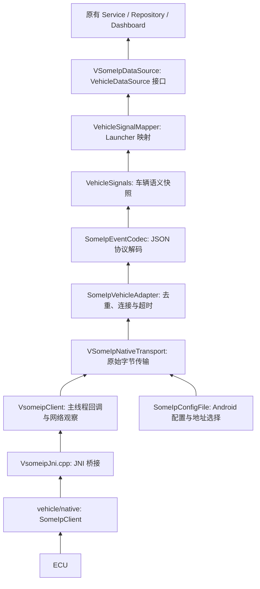

# vSOME/IP 现有链路分层

日期：2026-09-28。范围：保持 APK 内 JNI/vsomeip 通信，对现有实现做渐进分层。
依据：[分享对话](https://chatgpt.com/share/6ab9f9ad-a514-83e8-aca6-f44e7baa2014)，以及本次明确选择的“先完成现有链路分层，保留 JNI/vsomeip”。

## 当前落地结构



| 层 | 实现 | 边界 |
|---|---|---|
| Native 通信 | `vehicle/native/someip/SomeIpClient.{h,cpp}` | vSomeIP 生命周期、服务请求/订阅、原始 payload、响应匹配；不依赖 JNI、VehicleState、VHAL |
| Android/JNI 宿主 | `app/src/main/cpp/jni/VsomeipJni.cpp` | JNI 导出同步匹配新 Java 包名，保留方法签名和回调编号，组装实际服务 ID，处理字节数组；不直接使用 vsomeip 类型 |
| Android 配置 | `com/example/vehicle/someip/android/SomeIpConfigFile.kt` | asset 复制、私有目录、网卡选择、unicast 重写 |
| 原始传输 | `com/example/vehicle/someip/transport/NativeVehicleTransport.kt`、`someip/android/VSomeIpNativeTransport.kt` | start/stop、availability、ByteArray、错误；不解码、不去重、不生成 UI 模型 |
| 车辆适配 | `com/example/vehicle/someip/adapter/` | 持有连接监视器，检查事件身份和接收超时，输出语义快照及通信状态；不依赖 Android 时钟或 Launcher 模型 |
| 协议解码 | `com/example/vehicle/someip/codec/` | JSON v1 解码和旧 Method 编码，类型、长度、范围、枚举映射、单位转换 |
| 中间模型 | `com/example/vehicle/model/VehicleSignals.kt` | 无 Android/Launcher 依赖，车速单位 m/s、温度 °C、电量百分比 |
| Launcher 映射 | `com/example/carlauncher/data/someip/VehicleSignalMapper.kt` | 语义枚举转 UI 枚举，m/s 转 km/h，生成原有 VehicleState |
| 应用数据源 | `com/example/carlauncher/data/someip/VSomeIpDataSource.kt` | 调度周期检查，将适配层状态映射为 DataSourceStatus，发布 VehicleState |

Kotlin 仍在原 `:app` 模块编译；这是职责目录与包名隔离，不是独立 Gradle 模块或跨进程隔离。车辆侧代码归入 `com.example.vehicle`，Launcher 接入代码归入 `com.example.carlauncher.data.someip`，测试同步放到对应包下。Native 单独构建为 `vehicle_someip` 静态库，由原 `libcarlauncher.so` 链接；APK 仍携带 `libvsomeip3.so`。

```text
app/src/main/
├── java/com/example/
│   ├── carlauncher/data/someip/   # 数据源、Launcher 映射、兼容门面
│   └── vehicle/
│       ├── model/                # 与协议无关的车辆信号
│       └── someip/
│           ├── codec/            # Event 解码、Method 编码
│           ├── adapter/          # 流适配、连接健康、去重
│           ├── transport/        # 原始传输接口
│           └── android/
│               ├── *.kt          # JNI 传输实现、配置文件
│               ├── jni/          # VsomeipClient JVM 桥
│               └── network/      # Android 网络观察及状态归约
└── cpp/
    ├── CMakeLists.txt            # APK Native 构建入口
    ├── jni/VsomeipJni.cpp        # JNI 导出及回调
    └── config/VehicleSomeIpConfig.hpp
vehicle/native/
├── CMakeLists.txt                # vehicle_someip 静态库目标
└── someip/SomeIpClient.{h,cpp}    # Native vSomeIP 通信
```

`src/test/java` 和 `src/androidTest/java` 镜像上述包路径；涉及完整 Launcher/Service 的网络探针归 `com.example.carlauncher.service`。移动 JVM 桥后，`FindClass` 和 JNI 导出名均使用 `com.example.vehicle.someip.android.jni.VsomeipClient`，库名仍是 `carlauncher`，Kotlin 与 Native 产物需一起重建。历史日期文档与审批归档保留当时路径；当前探针操作文档已更新。

## 协议与兼容性

服务身份仍由 `app/src/main/cpp/config/VehicleSomeIpConfig.hpp` 集中定义，JNI 宿主通过 `SomeIpServiceDefinition` 注入 Native client：

| Service | Instance | Event | Event group | Method |
|---|---|---|---|---|
| 0x1111 | 0x2222 | 0x8001 | 0x0001 | 0x1001 |

事件为既有完整 JSON v1 快照，长度上限 4096 字节。Method 保留原 16 字节探针协议；长度检查在 JNI 兼容入口，Native transport 将 payload 视为不透明字节。请求响应仍按 client/session 匹配并去重，3 秒过期；Native 日志不再解读 payload 内的车辆 sequence。

`VehicleEventCodec.decode` 保留为兼容门面，委托“SomeIpEventCodec + VehicleSignalMapper”；真实接收链路分别在 adapter 解码、data source 映射。原协议边界测试继续经过该门面验证字段和值没有改变。

| JSON 字段 | 中间语义 | Launcher 字段 |
|---|---|---|
| seq / timestampMs | sequence / sourceTimestampMs | sequence / timestampMs |
| speedKph | speedMetersPerSecond = speedKph / 3.6 | 四舍五入还原 vehSpeedKph |
| rpm | engineRpm | engRpm |
| soc | stateOfChargePercent | soc，保留现有模型截断规则 |
| gear / turnSignal / warning | 独立语义枚举，映射表固定在 codec | Gear / TurnSignal / WarningState |
| validity / dataStatus | SignalValidity / SignalSourceStatus | DataValidity / DataStatus |
| parkingBrake / doorLock / beltWarning | parkingBrake / doorLocked / seatBeltWarning | 原有布尔字段 |
| headlightsState / highBeamLightsState | headlights / highBeam | 原有灯光字段 |
| engineCoolantTemp | coolantCelsius | engineCoolantTemp |
| evBatteryLevel | batteryPercent（本 PoC 的百分比） | 原有 evBatteryLevel |

原始越界值先在 codec 标记有效性，再交给 Launcher 模型处理，避免先截断数值后误判为正常。

## 生命周期与状态

Service 的单线程执行器仍负责完整 start/stop 事务，Native IO 线程仍独立运行。Native 回调只转发，禁止在其回调线程同步调用 start/stop/send；Android 桥将事件排队到主线程。适配器的本地时间由构造函数注入，生产使用 `SystemClock.elapsedRealtime`，测试使用可控时钟。

Service 启动入口收敛为 `onCreate → startVsomeipClient → executor.execute { source.start(dataListener) }`，移除重复的 `runVsomeipStart` 包装。执行器不可用、任务被拒绝、数据源未进入运行状态以及启动异常均由 `handleStartFailure` 统一记录失败，并发布 `ERROR` 和 `START_FAILED`。已经执行的数据源启动失败时，在同一后台执行器中先清理再报告；只有确认运行才记录启动成功。Service 保存回调更新后的状态，避免数据源旧状态遮蔽启动失败，停止后的迟到状态和错误回调不再覆盖 `STOPPED`。

- 去重按 `(sourceTimestampMs, sequence)` 比较。同一时间只接受更大 sequence；更新的时间戳允许发布端 sequence 重置；丢包后的 sequence 跳跃可接受。
- 不可用和停止会清除去重基线；不可用期间的事件不被接受。
- 只有成功解码且通过去重的事件刷新通信期限。重复帧、非法帧、重复 available 都不延长 3000 ms 期限。
- TIMED_OUT 表示流健康超时，映射到应用 NO_DATA。新的合法事件可恢复 AVAILABLE。数据本身的 NO_DATA/INVALID 不等同于通信断开。
- start 失败会移除监听、释放传输资源并返回非运行状态，可显式重试。
- adapter 使用会话代次丢弃旧监听回调；每轮 JNI 监听使用独立对象身份，使 Java 主线程队列中的旧回调不能穿透 stop/start。
- UI 诊断所用 `SomeipConnectionMonitor.Snapshot` 暂时保留，Dashboard 文案和前台 Service 所有权未在本次迁移。

## 后续 VHAL 迁移边界

本次不新增独立 AIDL VHAL 服务，也不改写现有 VhalVehicleDataSource。下一阶段在平台工程实现 Native codec/adapter 和 `VehiclePropertyMapper`，以相同协议样本对照 Kotlin 路径。当前 Kotlin 信号层是隔离后的协议参考实现，不是已经可链接到 C++ VHAL 的组件。

Native client 当前是每实例一个服务定义，并使用 vSomeIP 进程环境配置；当前宿主仍是进程级单例。多服务矩阵、多进程部署、Soong/SELinux/init、属性区域、权限和读写能力，需要按实际 AAOS 版本及 ECU 接口补齐。

不要直接照搬分享对话中的电量示例：当前 PoC 的 `evBatteryLevel` 是 0–100 百分比，而 AAOS `EV_BATTERY_LEVEL` 的单位是 Wh，需要电池容量信息才能做有意义的转换。[AOSP 属性定义](https://android.googlesource.com/platform/hardware/interfaces/+/refs/heads/android16-qpr1-release/automotive/vehicle/aidl_property/android/hardware/automotive/vehicle/VehicleProperty.aidl)

车辆发布端 epoch 毫秒、Android 接收端单调毫秒、VHAL 时间戳也不能直接混用；下阶段需明确接收时刻和源时刻的转换。当前去重使用源时刻，watchdog 使用本地单调时刻。

## 验证与复现

Service 启动入口合并后，新增 10 项启动编排回归测试，覆盖后台执行、未进入运行状态、执行器不可用或拒绝任务、部分启动后的异常清理、Native 加载和清理异常，以及停止后的迟到失败与回调。全量 234 项 JVM 测试通过（无失败或跳过），Debug APK 构建及分层依赖检查通过。以下设备测试结果来自此前目录整理验证，本次 Service 修改未重跑设备测试。

保留现有 JUnit4/Android instrumentation，不增加测试框架。Android CLI 查询被本机缓存锁权限阻止，采用已安装 Android 测试参考资料；构建使用项目配置的 Java 21 Gradle daemon、SDK 36.1、NDK 28.2.13676358。

```powershell
./tools/check-someip-layering.ps1
./gradlew.bat :app:testDebugUnitTest :app:assembleDebug
./gradlew.bat :app:connectedDebugAndroidTest '-Pandroid.testInstrumentationRunnerArguments.class=com.example.vehicle.someip.android.jni.VsomeipClientTest,com.example.vehicle.someip.android.VSomeIpNativeTransportConfigTest,com.example.vehicle.someip.android.network.AndroidNetworkMonitorTest'
```

目录和包名整理后的验证：224 项 JVM 测试全部通过，其中 SOME/IP 154 项；Debug x86_64 Native/APK 构建通过；Android 15 Automotive 模拟器上的 JNI 入口绑定、JNI 回调、配置及网络观察测试 5 项通过。新增 JNI 绑定测试使用空配置和无效入参检查所有 native 方法，验证新包名的导出及 FindClass 路径，不启动车辆网络。适配器测试覆盖去重、重连、超时、启动失败、迟到回调、语义单位及边界往返。

报告：`app/build/reports/tests/testDebugUnitTest/index.html`、`app/build/reports/androidTests/connected/debug/index.html`。设备测试的 coverage.ec 提取提示文件不存在，因此不声明设备覆盖率或全模块覆盖率门禁通过。真实 ECU/Ubuntu peer 网络探针本次未运行。
