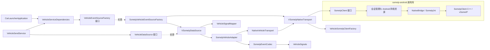

# vSomeIP 通用库与车辆适配边界

更新：2026-10-15。通用传输已提取为独立 Android Library `:someip-android`；
车辆协议和 Launcher 接入保留在 `:app`。详细 API、接入示例和限制见
[库说明](../someip-android/README.md)。

## 当前依赖



| 所属模块 | 职责 | 不承担的职责 |
|---|---|---|
| `:someip-android` 公共 API | 配置 service/instance/event/group/method、启停、availability、字节请求与事件、响应状态 | 车辆字段、JSON schema、Launcher 状态 |
| 库内部 Android/JNI | 单会话占用、回调代次、主线程分发、网络观察、组播锁、JNI 参数封送 | Service 生命周期、asset 名称、IP 选择 |
| 库内部 C++ | vSomeIP 生命周期、订阅、字节传输、client/session 响应匹配和去重 | JNI 类型、业务编码、VHAL |
| app `VehicleSomeIpClientFactory` / `SomeIpConfigFile` | 选择 JSON 配置源、生成私有运行时配置、显式 auto 地址解析 | JNI 或 vSomeIP 内部 API、硬编码端点 |
| app `SomeIpVehicleAdapter` / codec | 车辆 JSON、去重、连接健康、3000 ms 事件超时、语义模型 | native 运行时管理 |
| app `VSomeIpDataSource` / mapper | watchdog 调度、状态映射、发布 `VehicleState` | 报文解析、native 调用 |

应用只通过 `implementation(project(":someip-android"))` 依赖库。库不依赖 `:app`、
`com.example.vehicle` 或 `com.example.carlauncher`；边界脚本已加入 CI。
应用的 `NativeVehicleTransport` 是车辆适配器使用的窄接口，
`VSomeIpNativeTransport` 负责将库的通用事件转换到这个接口。

### 耦合审计（2026-10-15，JSON 配置迁移后）

检查了 app 生产源码、资源、测试探针、模块 Gradle、库 JNI/native、Manifest、consumer rules 和 CI。
当前 app 生产代码只有以下三个文件引用通用库公共 API：

| 文件 | 公共 API | 用途 |
|---|---|---|
| `VehicleSomeIpClientFactory.kt` | `VSomeIp.create`、`SomeIpClient` | 从 JSON 创建客户端 |
| `VSomeIpNativeTransport.kt` | `SomeIpClient`、`SomeIpClient.Listener` | 启停、可用状态、字节事件与回调转换 |
| `SomeIpConfigPreparer.kt` | `SomeIpClientConfig.fromJson` | 写入运行时文件前校验配置 |

未发现业务层调用 JNI、加载 SOME/IP `.so`、引用库内部类、设置 vSomeIP 环境变量或直接链接原生库。
JNI、网络观察、组播锁、R8 JNI keep 规则和 CMake 均由库承担；库未反向依赖车辆或 Launcher 包。
设备探针也通过公共 API 接入，没有保留旧 JNI 旁路。

仍存在的关联需要区分清楚：

- **组装关联（已收束）**：`CarLauncherApplication` 通过 `VehicleServiceDependencies` 提供
  `VehicleEventSourceFactory` 接口，`SomeIpVehicleEventSourceFactory` 是创建具体 Transport/DataSource 的唯一生产组装点。
  Service 只持有 `VehicleDataSource`，不导入具体实现；替换实现时调整 Application 的工厂绑定即可。
- **宿主配置关联**：asset/override 文件采用 vSomeIP JSON 格式，`SomeIpConfigFile` 负责路径和本机 IP 策略，
  `SomeIpConfigPreparer` 处理 `unicast=auto`。这些配置策略与通信实现有关，但没有进入业务 codec/UI。
- **业务协议关联**：车辆 JSON schema、去重、超时、`SomeipConnectionMonitor` 以及 UI 的 SOME/IP 状态文字仍在 app。
  `CockpitUiState` 直接使用应用自己的 monitor snapshot，属于协议状态展示关联，不是通用库内部类型泄漏。
- **构建关联**：仓库的第三方源码、native 构建/校验工具及 CI 仍需构建 vSomeIP；app 仅依赖 `:someip-android`，
  ABI 选择需与库产物一致。

发现并修复 UI 状态和中英文资源写死 `EVENT 0x8001` 的残留：移除固定编号，避免修改 JSON 后仍显示旧 event。
codec 注释也不再把车辆 schema 绑定到固定 event ID。运行时订阅参数仍完全来自 JSON。

边界脚本增加公共 API 调用文件白名单，扫描所有生产 source set 的 Kotlin/Java/C/C++，
并阻止直接 JNI/native 引用、环境变量旁路、私带 SOME/IP `.so` 和 Gradle 原生依赖。
这是源码文本检查，不替代编译器或动态行为验证；现有 CI 会执行该脚本。
隔离临时副本验证了 7 种违规均被拒绝，原始副本和当前源码均通过。
最初审计修正文案时应用 257 项 JVM 测试通过（0 失败、0 跳过），Debug APK 构建、Detekt、Lint 通过。
该阶段通信运行时代码未修改，未重复设备 native 验收；后续工厂注入验证单独记录如下。

### Service 工厂接口注入（2026-10-15）

`VehicleEventSourceFactory.create(context, monitor)` 返回未启动的 `VehicleDataSource`，
实现不得在 create 时持有已启动的通信资源。Service 从 Application 的依赖接口取得工厂，
在进程共享的单线程执行器中创建、启动、停止数据源；创建失败也进入统一启动失败处理。
Service 重建时旧实例的清理排在新实例的创建之前，销毁后排队的创建不会执行；
创建过程中销毁则不启动返回的数据源，由后续停止任务释放。

`getLatestVehicleState` 只读取 `VehicleDataSource.Listener` 回调缓存，不再读取具体数据源的属性。
Service 的 `someipStatus` 与工厂参数保留应用层 `SomeipConnectionMonitor`，以兼容现有 UI；
这次消除了具体通信实现的创建依赖，没有将协议状态模型改造成通用监控 API。
现有 Mock/VHAL 的 `VehicleDataSourceFactory` 用途保持不变。

Service 的 JVM 测试改为注入纯 `VehicleDataSource` fake 和工厂接口，不再反射私有字段或继承具体数据源。
边界脚本增加 Service 禁止引用具体 Transport/DataSource/工厂实现的检查，覆盖所有生产 source set。

本次应用 JVM 回归 261 项通过，其中 Service 编排 17 项，覆盖工厂异常/LinkageError、销毁前后竞态、
失败清理、晚到回调、VM error 传播和跨实例启停顺序。Debug APK、设备测试编译、Detekt、Lint 通过，
Lint 为 0 错误及 20 项既有更新提示。隔离副本中 main/Kotlin 和 debug/Java 的 Service 越界引用均被拒绝。
Android 15 Automotive x86_64 上 `CarLauncherApplicationTest` 2 项与 `VehicleSendServiceTest` 6 项通过，
验证真实 Application 的接口工厂可创建未启动数据源，以及默认状态、Binder、主线程通知。
这些轻量设备测试没有启动完整前台服务或验证真实 peer；LAN 生命周期探针已适配新字段并通过编译，未在本轮执行。
设备覆盖率文件提取仍有 Automotive 用户目录问题，不据此声明覆盖率通过。

```text
someip-android/
  build.gradle.kts                 # AAR / native / tests / static analysis
  consumer-rules.pro               # JNI callback and exported method names
  src/main/java/com/example/someip/
    SomeIpClient.kt                # public capability contract
    SomeIpClientConfig.kt          # caller-supplied endpoints and payload limits
    VSomeIp.kt                     # Android factory
    internal/                      # JNI, session ownership, network resources
  src/main/cpp/
    CMakeLists.txt                 # libsomeip_jni.so + source-built libvsomeip3.so
    jni/SomeIpJni.cpp
    native/someip/SomeIpClient.{h,cpp}
app/src/main/java/com/example/
  vehicle/someip/
    android/                       # app configuration policy and interface adapter
    adapter/                       # deduplication, stream health
    codec/                         # vehicle JSON and legacy method schema
    transport/                     # app's narrow raw transport port
  carlauncher/data/someip/          # Launcher mapping and data source
```

旧 `VsomeipClient` 静态桥、`libcarlauncher.so`、C++ 车辆配置头已移除；
新的 JNI 类是库内部的 `com.example.someip.internal.NativeBridge`。
JNI 与 Kotlin 必须一起重建，不能混用旧 APK 的 native 产物。

## 保留的车辆协议

CarLauncher 仍使用 service `0x1111`、instance `0x2222`、event `0x8001`、
event group `0x0001`、method `0x1001`、application `soc-vehicle-client`。
这些值集中在 `app/src/main/assets/vsomeip-client.json` 的 `client-endpoint` 中，
应用工厂通过 `VSomeIp.create(context, configFile)` 读取；事件上限 4096 字节，
旧 method 的 16 字节 schema 留在应用 codec/探针。
通用库只验证配置与长度上限，允许零长度及其他长度的原始字节。

事件仍是 JSON v1 完整快照。车速在协议与语义层之间进行 km/h 和 m/s 转换；
`VehicleSignalMapper` 转回 Launcher 模型。车辆 `evBatteryLevel` 仍是百分比，
不能直接当作 VHAL 电量 Wh。源时间用于去重，本地单调时间用于 watchdog。

- 按 `(sourceTimestampMs, sequence)` 去重；新源时间允许 sequence 重置。
- 只有合法且非重复事件刷新 3000 ms 期限；重复 available、非法帧不续期。
- unavailable/stop 清除去重基线；超时映射到应用 NO_DATA，合法事件可恢复。
- Service 继续在自己的单线程执行器中编排 start/stop、统一处理启动失败。

## 库生命周期约束

同一进程只允许一个活动 session。重复启动同一 client 幂等；其他 client 启动返回 false，
不能夺取 listener、发送或停止已有会话。失败启动释放监听、网络观察、组播锁与 native 资源；
旧代次排队回调不能进入新 session。宿主结束时应调用 `stop` 或 `close`。

vSomeIP routing base path 在进程内首次使用时缓存，配置文件父目录因此固定；
跨目录重配需重启进程，同目录的新配置可在 stop 后加载。
启动成功、服务 AVAILABLE、请求提交、响应成功分别表示不同事实。
当前公开接口仅提供响应状态，不提供服务端、多服务矩阵、请求 token、响应正文或请求超时通知。

## 验证与复现

```powershell
.\tools\check-someip-layering.ps1
.\gradlew.bat :app:detekt :someip-android:detekt
.\gradlew.bat :someip-android:testDebugUnitTest :app:testDebugUnitTest
.\gradlew.bat :someip-android:assembleDebug :app:assembleDebug
.\gradlew.bat :someip-android:lintDebug :app:lintDebug
.\gradlew.bat :someip-android:compileDebugAndroidTestKotlin :app:compileDebugAndroidTestKotlin
```

设备 JNI/网络回调测试位于库的 `src/androidTest`；车辆协议 LAN 探针和完整 Service
生命周期探针保留在 app，通过公共 API 接入。JVM/编译结果与设备、Ubuntu peer 联调结果分开报告。

2026-09-28 的 234 项 JVM、旧 JNI/页面设备测试和构建记录属于提取前的历史基线，
不能用作此次模块迁移的设备验收证据。历史日期文档和审批归档保留当时路径。

2026-10-15 本地提取验证：应用 251 项、库 24 项 JVM 测试均通过（0 失败、0 跳过）；
Debug APK/AAR 构建通过，两个模块 Detekt 均为 0 findings，依赖边界脚本通过。
AAR 含 `libsomeip_jni.so`、`libvsomeip3.so` 和 `libc++_shared.so`，APK/AAR 中的
vSomeIP SHA-256 均与 `build/native/artifact` 的源码构建产物一致。

Android 15 Automotive x86_64 模拟器已通过库的 5 项 instrumentation 测试：
JNI 绑定 1 项、主线程回调与旧代次过滤 2 项、网络观察生命周期 2 项。
应用侧 `nativeRegistrationAndRepeatedStopAreSafe` 另通过 1 项，日志确认三轮真实 native
注册、重复 start、重复 stop 与重新启动；使用模拟器地址 `10.0.2.16` 和关闭 SD 的探针配置，
不将注册成功视为 peer 响应成功。合计 6 项设备测试，0 失败、0 跳过。
两个模块 Lint 均为 0 错误；应用 20 项、库 1 项警告为依赖/SDK/target 更新提示，未改动现有版本。
本轮没有真实 ECU/Ubuntu peer 请求响应或 SD 联调证据。
应用设备测试的 `coverage.ec` 提取出现 Automotive 用户目录下 `run-as` 路径失败，
因此不声明设备覆盖率或全模块覆盖率门禁通过；JUnit 结果与三轮启停日志均已核对。

报告位于 `app/build/reports/tests/testDebugUnitTest/`、
`someip-android/build/reports/tests/testDebugUnitTest/`、
两模块的 `build/reports/androidTests/connected/debug/` 及 `build/reports/lint-results-debug.html`。

### JSON 启动配置增量验证（2026-10-15）

启动参数从 Kotlin 工厂迁入 asset 的 `client-endpoint`；通用库提供
`VSomeIp.create(context, configFile)`。配置字段、覆盖文件优先级与重新加载方式见
[`someip-android/README.md`](../someip-android/README.md#json-启动配置)。

应用 257 项、库 33 项 JVM 测试通过，共 290 项（0 失败、0 跳过）。新增 15 项覆盖
JSON 字段与范围校验、应用名匹配、配置重读、override 优先级、固定 IP 保留、auto 选址、
非法输入不覆盖已有 runtime 文件。Debug APK/AAR、设备测试编译、两模块 Detekt 与 Lint 通过；
Lint 仍为 0 错误、应用 20 项和库 1 项既有更新提示。

Android 15 Automotive x86_64 模拟器执行以下 3 项设备测试，0 失败、0 跳过：

- `VSomeIpNativeTransportConfigTest` 两项：真实 Android JSON 解析和 override，以及地址改写保留远端配置。
- `VsomeipNativeProbeTest#nativeRegistrationAndRepeatedStopAreSafe` 一项：经文件 API 读取 JSON，
  完成三轮真实 native 注册与启停。探针关闭 SD，使用本机 `10.0.2.16`，不代表真实 peer 通信验收。

本轮设备覆盖率文件提取仍遇到前述 Automotive 用户目录问题；测试结论来自 JUnit XML 与 native 日志。
